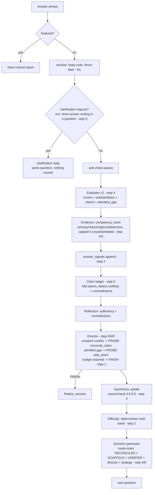
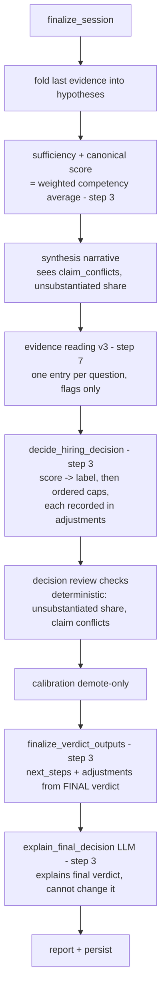

# Implementation Plan

> Turns `docs/PROBLEMS_AND_SOLUTIONS.md` (P1–P12, N1–N9) into ordered, separately testable steps. Full prompt texts are in
> `docs/PROMPTS.md`. Written 2026-11-07 against `dev` at `a162c83` plus the uncommitted evidence-reading/`flag_review` change.
>
> **Candidate-facing decisions (made by the user, 2026-11-07):**
> 1. Conflicting figures: the interviewer **asks about it neutrally** in the next question (RECONCILER mode), once per conflict.
> 2. Difficulty: **slower drop with a hold band**. It drops only after two weak windows in a row and rises after strong ones.
> 3. An answer that ends by asking the interviewer something: **clarify, then let them answer**. The partial answer is not scored.
> 4. After "I haven't done X": **one fundamentals question on the same topic** (SCAFFOLD mode), then move on.
>
> Any other change to what the candidate sees or hears needs the user's approval first.

## How to use this plan

- Do the steps in order and commit each one separately (`fix:` / `feat:` prefix, as in the git log). Don't start a step until the
  previous step's gate passes.
- **Unit tests:** `venv/Scripts/python.exe -m pytest -q` must pass after every step. When a test encodes behaviour this plan
  changes on purpose, update its expectation and say so in the commit message. Never delete a test's intent.
- **Harness gate:** `venv/Scripts/python.exe tools/interview_sim/run.py <personas> -q 14 --repeat N --out tools/interview_sim/out/stepK`,
  then `summarize.py tools/interview_sim/out/stepK/*`. Discard any run with 429s or `CRASH`. Each step lists its personas, its repeat
  count and what a passing result looks like.
- **Cost:** one interview is under 1 cent on paid OpenRouter, so a 4-persona ×2 gate is about 5–8 cents. The full plan needs about
  12 gates.

## Overlaps merged

| Merged change | Covers | Why it is one change |
|---|---|---|
| **Evaluator v2** (one prompt plus parser, step 4) | P1 rubric, P2 claim extraction, P5 per-answer verifiability, P6 gap detection, N2 injection fencing, N3 length, P12 scale | Every item needs the evaluator to read the same single answer. One call per turn returns scores, substantiation, claims and flags, so there are no extra LLM calls. |
| **One decision function** (step 3) | P1 double counting, P4 difficulty credit, P7 next steps and rationale, N4 two "confirmed ratio" formulas | The canonical score, the legacy recommendation verdict and the 7-point decision all map scores to labels in three different places today. They become one score, one mapping and one ordered list of caps, each recorded as an `adjustment`. |
| **Claim ledger** (steps 5 and 6) | P2, the evidence-reading contradiction part of P5, the director's rotation-on-contradiction conflict | Contradictions become deterministic records in the existing `contradictions` list, so every current consumer (sufficiency, director, difficulty, decision) sees them without new plumbing. The director rule that *rotated away* from two serious contradictions would defeat the user's "ask about it" choice, so it changes in the same step. |
| **Difficulty hold band moves into step 2** | P4 | Step 2 lowers evidence scores by about 1.5 points. With today's "window < 7.0 → −1" rule that would push even strong candidates down. Changing both together keeps the build consistent. |
| **Evidence reading becomes secondary** (step 7) | P5, P11 | Once steps 4 and 5 provide per-answer verifiability and contradictions, the end-of-interview read only flags. That simplifies the `flag_review` and demotion rules. |
| **Mode resolution rewrite** (steps 6 and 8) | P6, P8, the gap step-down, RECONCILER priority | All of these change the priority order in `_resolve_interview_mode`. Step 6 adds only RECONCILER at the top; step 8 does the rest. |

## Design changes

### D1. New per-turn data on the brain (no DB migration)

The brain is stored as one JSON document (`v4_session_store` checkpoint), so new fields need only a dataclass declaration in
`app/core/interview_brain.py`. Without that declaration `sync_from_dict` drops them (it only copies keys for which
`hasattr(self, k)` is true).

```python
# app/core/interview_brain.py, new fields
answer_signals: list = field(default_factory=list)   # step 4: one dict per scored answer
claim_ledger: list = field(default_factory=list)     # step 5: every measurable claim
claim_conflicts: list = field(default_factory=list)  # step 5: detected conflicts (also mirrored into `contradictions`)
low_windows: int = 0                                 # step 2: consecutive low difficulty windows
scaffolded_competencies: list = field(default_factory=list)   # step 8
challenged_competencies: list = field(default_factory=list)   # step 8
```

Record shapes:

```python
# answer_signals[i]  (step 4)
{"question_number": 7, "competency": "tech_caching", "competency_score": 5.5,
 "verifiable": False, "specifics": [], "unsupported_claims": ["99% cache hit"],
 "admitted_gap": False, "asked_interviewer": False, "inflation_admitted": False}

# claim_ledger[i]  (step 5)
{"id": "<uuid>", "metric_key": "settlement_time_reduction", "value_text": "93%", "number": 93.0, "unit": "%",
 "question_number": 3, "competency": "tech_system_design", "quote": "a 93% reduction in settlement time"}

# claim_conflicts[i]  (step 5); a copy goes into brain.contradictions with type "claim_conflict"
{"id": "<uuid>", "type": "claim_conflict", "metric_key": "settlement_time_reduction",
 "first": {"question_number": 3, "value_text": "93%"}, "second": {"question_number": 5, "value_text": "85%"},
 "kind": "changed_value | explicit_correction | inflation_admitted",
 "severity": "medium | high", "status": "open | asked | explained | unexplained",
 "asked_in_question": null, "statement": "settlement_time_reduction: 93% (Q3) vs 85% (Q5)",
 "competency": "tech_system_design", "evidence_ids": []}
```

The final report (`build_report_response`) gets a `claim_conflicts` list and `unsubstantiated_share` (step 5). The persisted
`contradictions` (via `v5_brain_persister`) carry the conflicts automatically because they are mirrored there.

### D2. Per-turn flow after the plan



The difference from today: the early `question_number >= max_questions → finalize` exit (before evaluation) is removed (step 1),
the claim-ledger node is new, and the director and the mode resolution gain two modes.

### D3. Finalization after the plan



Today the LLM explanation and the next steps are produced *before* review and calibration (`hiring_decision_node`), which is why a
demoted interview still said "prepare offer discussion".

### D4. Claim ledger module (step 5)

New file `app/agents/reasoning/claim_ledger.py`, pure and deterministic:

- `parse_value(text) -> (number | None, unit)`: handles `93%`, `350 ms`, `2.1 million rps`, `4 hours`, and `x` multipliers. Ranges
  and "from A to B" keep the last number and are marked as `range`, so they are never compared.
- `fold_claims(ledger, claims, question_number, competency, evidence_ids) -> ledger`
- `detect_conflicts(ledger, new_entries, corrections, inflation_admitted, question_number) -> list[conflict]`:
  - **changed_value:** same `metric_key`, same unit, both numeric, a relative difference above 10% and an absolute difference above
    1 unit (so 0.02% versus 0.04% only counts if the unit is a percentage of a *result*). Severity medium.
  - **explicit_correction:** an evaluator `corrects_earlier_claim` item whose `metric_key` exists in the ledger. Severity medium.
  - **inflation_admitted:** severity high, recorded even without an earlier claim.
  - A second unresolved conflict on any metric raises all open conflicts to high.
- `known_claims_brief(ledger, limit=12) -> str`: the `metric_key: value (Qn)` list for the evaluator prompt, so it reuses keys.
- `next_conflict_to_reconcile(conflicts) -> conflict | None`: the oldest `open` one.
- `settle_after_reconcile(conflict, answer_signal)`: after the RECONCILER question is answered, the status becomes `explained` when
  that answer is substantiated (`verifiable`) and created no new conflict; otherwise `unexplained`. Explained conflicts are severity
  low and never block a hire.

Engine wiring: `answer_processor.process_answer` calls `apply_claim_ledger(s)` right after `explainable_scoring_node`. It folds
`s["unified_evaluation_extras"]` (step 4) into `claim_ledger`, appends conflicts to `claim_conflicts` and mirrors them into
`contradictions`.

---

## Steps

### Step 0: Commit the current change and make the harness measure what the plan needs

**Covers:** the baseline for every later gate; it also hides nothing (P3 was hidden by `turns[:-1]`).

**Files**
- Commit the uncommitted `prompts/evaluation/evidence_reading.md`, `app/agents/reasoning/evidence_reading.py` and
  `app/agents/decision/decision_review.py` changes (`fix: evidence reading counts only real contradictions; flag_review needs a real
  finding`).
- `tools/interview_sim/summarize.py`:
  - Count unscored turns over **all** turns (drop `[:-1]`).
  - Print `ev_minus_turn` = mean evidence score − mean per-answer score.
  - Print `contradictions` (count of `claim_conflict` and serious ones), `flag_review`, `demotion_reason` and p95 turn seconds.
  - Print `question_source` counts once step 8 adds the field (until then `fallbackQ` stays).
  - With several run folders, end with a per-persona verdict tally (for example `bluffer: hire×1 lean_hire×1`).
- `tools/interview_sim/run.py`: add `--repeat N`, which runs each persona N times into `OUT/rK/` subfolders.

**Test**
- `pytest -q` passes.
- Baseline gate `step0`: strong, bluffer, weak and awkward ×2. Expected (this is the "before" picture, not a pass/fail): the last turn
  is unscored in 8/8, `ev_minus_turn` is about +1.4 to +2.2, and the bluffer gets a hire-side verdict in at least 1 of 2.

---

### Step 1: Score the final answer (P3, N7)

**Files**
- `app/engine/answer_processor.py`: delete the block at lines 97–101
  (`if question_number >= brain.max_questions: return await finalize_session(...)`). The answer then goes through evaluation and
  evidence, and `director._director_decision` returns FINISH at the budget (`director.py:190`), which calls `finalize_session`.
  The `finalized` guard at line 30 still answers late or duplicate messages.
- Check that `finalize_session` folds `extracted_evidence` into the hypotheses (it does, lines 153–158), so the 14th answer
  counts.

**Unit tests (new, `tests/test_engine_v5_flow.py`)**
- A 3-question session with stubbed LLMs: after the third answer the evidence store contains `question_number == 3` and the
  response is the report (`interview_complete: True`).
- Sending a 4th answer returns the same report without re-scoring.

**Gate** `step1`: strong ×1, weak ×1. Pass: `unscored=0` with the corrected count, evidence question numbers 1–14, and 14 answers
in the transcript.

---

### Step 2: Evidence carries the answer's competency score; hypotheses and difficulty use the corrected scale (P1 links 1, 3 and 4, P4)

**Candidate-facing:** yes, difficulty changes (approved: "slower drop + hold band").

**Files**
- `app/agents/evaluation/scoring.py`: new `competency_score(evaluation, category) -> float | None`. It's the weighted mean over the
  non-null dimensions, using the weights below, then rounded. It never uses `communication` or `confidence`. Add
  `COMPETENCY_SCORE_WEIGHTS` here, next to the rubric weights, as the single source.

  | Family | Weights |
  |---|---|
  | technical (default) | technical 0.5, reasoning 0.3, completeness 0.2 |
  | behavioral | behavioral 0.5, reasoning 0.3, completeness 0.2 |
  | cognitive | reasoning 0.6, technical 0.2, completeness 0.2 |
  | every domain family (`domain` primary) | domain 0.5, reasoning 0.3, completeness 0.2 |

- `app/agents/reasoning/evidence_engine.py::build_candidate_evidence`:
  - `"score"` becomes `competency_score(...)`; fall back to the top dimension's score only when every weighted dimension is null.
  - Keep `"dimension"` as the primary dimension (not the top one), and add `"dimension_scores": {dim: score}` for observability.
  - Claim sentences still come from the primary dimension's `evidence` quote, with the top dimension as the fallback.
  - **Every scored answer produces at least one record** (P1 link 4). When no quote yields a claim sentence, create one record
    whose `evidence_text` is the first 300 characters of the candidate's answer (`state["candidate_answer"]`), flagged
    `"quote_missing": True`. Pass the answer into `build_candidate_evidence` as a new optional `answer_text` argument.
  - Update the module docstring, which still describes the "top-scoring dimension" rule.
- `app/agents/reasoning/hypothesis_engine.py::_evidence_support`: centre on the hire bar. Use
  `raw = 0.5 + (score10 - 6.5) / 7.0`, clamped to 0..1, where `score10 = normalized_score * 10`. A score of 6.5 is neutral, 10 is
  full support and 3 is full contradiction. Add `HYPOTHESIS_NEUTRAL_SCORE = 6.5` as a module constant.
- `app/agents/reasoning/evidence_engine.py::_supports_hypothesis`: use `>= 6.5` for support and `< 4.5` for contradiction. Between
  the two it's neutral: return `None`, and treat `None` as "no edge sign" in `update_evidence_graph`.
- `app/agents/planning/difficulty_engine.py` (hold band):
  - `_govern_deterministic`: +1 if the window average is ≥ 7.0 (lowered from 7.5 during implementation: on the de-inflated
    competency-score scale a clearly strong answer lands around 7–8, so 7.5 would rarely raise). −1 only if the window average
    is < 5.5 **and**
    `state["low_windows"] >= 1`. Otherwise 0.
  - Return the updated `low_windows`: +1 when the average is below 5.5, reset to 0 otherwise.
  - Replace the clamp block (lines 257–266) with the same three rules, so the LLM path can't disagree.
  - Never +1 with more than one serious contradiction, or with any `claim_conflict` (step 5) whose status isn't `explained`.
    (One serious contradiction alone no longer blocks: the evaluator flags one on many honest interviews.)
  - `routing.govern_difficulty`: call the LLM governor only when `os.getenv("DIFFICULTY_GOVERNOR_LLM") == "1"`, deterministic
    otherwise. This also covers P10, as the first four turns no longer make an extra LLM call.
  - Pass `low_windows` and `role_floor` into the prompt when it is used.
- **Gate result (2026-11-08, `out/step2a`, `out/step2b`):** unscored 0/8, strong peak difficulty 5 and hired ×2, weak no-hire ×2,
  bluffer hired 1/2 (was 2/2), `ev_minus_turn` +0.05…+0.88 (was +1.3…+2.0). **Not met:** awkward got `no_hire` ×2 and stayed at
  difficulty 1 in one run. Cause: removing the delivery bonus exposed the evaluator's harsh scoring of hesitant but concrete
  answers (e.g. a 1.7/10 for a concrete incident-communication answer). User decision: commit step 2 and **do step 4 before
  step 3**; step 4's gate re-checks awkward. Also fixed here: `max_difficulty_reached` was not declared on the brain, so the
  peak was dropped every turn.
- `app/core/interview_brain.py`: add `low_windows: int = 0`.
- `prompts/difficulty_governor/difficulty_governor.md`: replace it with **PROMPTS.md §7**.
- Thresholds that read evidence scores and must move with the new scale (check each and document the change in the commit):
  - `synthesis._evidence_strengths` (≥ 7.0 becomes ≥ 6.5)
  - `scoring.CALIBRATION_BANDS`: leave them, they apply to the per-answer composite
  - `director.VERIFY_SCORE_FLOOR`: uses `evaluation_score`, unchanged
  - `contradiction_engine.CONTRADICTION_DELTA`: unchanged

**Unit tests to update or add**
- `tests/test_evidence_quality.py`, `tests/test_competency_consistency.py` and `tests/new/test_phase_a.py`: the record score is
  now the competency score. Add a case where communication is 9 and technical is 5, and the record score is about 5.5.
- An evaluation whose quotes are all empty still yields one record, carrying the answer text and `quote_missing: True`.
- `tests/test_difficulty_governor.py`:
  - window 6.0 → hold
  - two consecutive windows at 5.0 → −1
  - window 7.6 → +1
  - claim conflict present and window 8 → hold
- `tests/test_hypothesis_information_gain.py` (and any status-transition test): a score of 6.5 doesn't move belief; 8.5 supports.

**Gate** `step2`: strong, bluffer, weak and awkward ×2. Pass:
- `ev_minus_turn` is between −0.3 and +0.5 for every run.
- `unscored=0` for every run (every answer produces evidence).
- awkward reaches difficulty ≥ 2 in both runs (difficulty 1 in round8).
- weak still ends on the no-hire side.
- strong still reaches difficulty ≥ 4.

Verdicts are *not* gated here: the decision formula still double-counts until step 3. Expect a lower decision score for the
bluffer.

---

### Step 3: One decision function, final outputs after review (P1 link 2, P4 credit, P7, N4, P12 in synthesis)

**Files**
- `app/agents/reasoning/contradiction_engine.py`:
  - `compute_canonical_score(competency_average_score, ...)` returns the **weighted competency average** over required
    competencies that have evidence. It keeps the signature but ignores `hypothesis_confidence` and `coverage_ratio`, keeping them
    in the docstring as "not scored; used as gates". The F5 ceiling becomes a no-op; remove it.
  - Coverage is no longer counted as zeros in the average; it's enforced by the caps below. This avoids double-penalising a short
    interview.
  - `evaluate_sufficiency`: the legacy `verdict` is derived from `decision_engine.map_decision(final_score)` through a fixed
    7-point → legacy table (strong_hire→strong_hire, hire→hire, lean_hire→borderline, insufficient_evidence→weak,
    lean_no_hire/no_hire/strong_no_hire→reject). This removes the second threshold table at lines 425–434. Keep the difficulty cap
    there only as a call into the shared cap function.
  - `resolved_hypothesis_confidence` becomes the only "confirmed ratio" (N4); `hiring_decision._decision_signals` calls it.
- `app/agents/decision/decision_engine.py`:
  - `compute_decision_score` returns the canonical score, with only the contradiction penalty (claim conflicts are handled as caps
    below, so the penalty here stays for score-inconsistency contradictions). The difficulty credit multiplication and the
    `(coverage − 0.5)` and `(confirmed − 0.5)` terms are removed.
  - `map_decision` gets initial thresholds on the new scale: strong_hire ≥ 8.0, hire ≥ 7.0, lean_hire ≥ 6.2,
    insufficient_evidence ≥ 5.0, lean_no_hire ≥ 4.0, no_hire ≥ 2.5. **Calibrate them at this step's gate**, then again after
    step 4 (see below), and record the final values plus the run folders in the commit message.
  - New `apply_decision_caps(decision, signals) -> (decision, adjustments)`, with the caps in this order. Each one appends
    `{"rule", "from", "to", "reason"}`:
    1. evidence_count < 4 → insufficient_evidence
    2. strong_hire and coverage < 0.85 → hire
    3. hire-side and coverage < 0.75 → at most lean_hire
    4. hire-side and coverage < 0.5 → insufficient_evidence
    5. hire-side and difficulty_reached < max(3, role_floor + 1) → at most lean_hire ("not tested at the role's level"). This
       replaces the multiplicative difficulty credit (P4): a candidate the engine never escalated isn't scored down, only kept off
       the top labels.
    6. (step 4) unsubstantiated share ≥ 0.5 and hire-side → insufficient_evidence
    7. (step 5) unexplained claim conflict and hire-side → insufficient_evidence; 2+ unexplained or any `inflation_admitted` →
       at most lean_no_hire
  - `decide_hiring_decision` returns `draft_decision` (label before caps), `decision`, `adjustments` and `flag_review`.
- `app/agents/decision/hiring_decision.py`:
  - `hiring_decision_node` becomes deterministic only, with no LLM call.
  - New `async def explain_final_decision(state) -> state` renders **PROMPTS.md §6** with the *final* decision, the `adjustments`
    and the fixed next steps, and stores `hiring_decision["llm_draft"] = {"rationale": ...}`. On LLM failure it uses
    `_decision_deterministic`.
- `app/agents/decision/decision_review.py::finalize_decision`: every demotion appends to `decision["adjustments"]` instead of only
  setting `demotion_reason`. Keep `demotion_reason` as the first adjustment's reason, for compatibility with the report builder and
  the harness.
- `app/engine/decision.py`:
  - `apply_calibration_verdict` appends an adjustment when it demotes.
  - New `finalize_verdict_outputs(state)` sets `hiring_decision["next_steps"] = decision_next_steps(final decision)` and
    `hiring_decision["draft"]`.
  - In `finalize_session`, call `finalize_verdict_outputs` after `apply_calibration_verdict`, then `explain_final_decision`.
- `app/agents/evaluation/synthesis.py`: `max_difficulty=f"Level {max_difficulty_reached(state)}/5"`, plus
  `claim_conflicts="None"` and `unsubstantiated_share="N/A"` until steps 4 and 5 fill them.
- `prompts/evaluation/synthesis.md`: **PROMPTS.md §5**.
- `prompts/decision/hiring_decision.md`: **PROMPTS.md §6**.

**Unit tests**
- `tests/test_decision_engine.py`:
  - Rewrite the `compute_decision_score` cases: a score equals the canonical score, with no +coverage or +confirmed terms.
  - Add the cap-order table test.
  - Add: competency average 8.5, coverage 1.0 and difficulty 2 gives lean_hire with a `difficulty` adjustment.
- `tests/test_report_consistency.py`: the report's decision, next steps and rationale agree. Add a draft strong_hire demoted by
  review that ends with probe-round next steps (`"schedule a short probe round"`).
- `tests/test_decision_review.py`: `adjustments` is populated.
- `tests/test_prompt_integrity.py`: add "no rendered prompt contains `/3`" for synthesis and the evaluator.

**Gate** `step3`: strong, bluffer, weak and awkward ×2. Pass:
- strong is hire-side 2/2 with decision score < 10.0
- weak is no-hire-side 2/2
- awkward isn't `no_hire` in either run
- no report with a decision of `insufficient_evidence` or lower has "offer" in its next steps

The bluffer may still be hire-side; that's for steps 4 and 5. **Calibration rule:** set the `map_decision` thresholds so the
strong runs clear hire with a margin of ≥ 0.3 and the weak runs fall below 5.0. Don't tune thresholds to push the bluffer down.
That's the rubric's and the ledger's job.

---

### Step 4: Evaluator v2: substantiation, claims and gap flags in the same call (P1 link 5, P5, P6 detection, N2, N3, P12)

**Files**
- `prompts/evaluation/unified_evaluator.md`: **PROMPTS.md §1**.
- `app/data/rubrics.py::ANCHORS`:
  - `technical` and `domain` "5-6" anchor: append "; large results stated without method or mechanism cap here".
  - `confidence` "9-10" anchor: "calibrated certainty: sure only where backed, honest about unknowns".
  - `confidence` "0-4" anchor: "bluffing, false expertise, or claims far beyond what is explained".
- `app/agents/evaluation/candidate_evaluator.py`:
  - Pass `known_claims=claim_ledger.known_claims_brief(state.get("claim_ledger") or [])` (or "None" before step 5 lands; the
    function returns "None" for an empty ledger).
  - Raise the answer cut from `answer[:3000]` to `answer[:6000]` (N3).
  - Run on `tier="strong"`. The `EVALUATOR_LLM_TIER=cheap` env var reverts this, following the `QUESTION_LLM_TIER` pattern in
    `question_generator._question_tier`.
  - Raise `max_tokens` from 1500 to 2200 for the larger JSON.
  - Parse the new top-level keys into `state["unified_evaluation_extras"] = {substantiation, claims, corrects_earlier_claim,
    inflation_admitted, admitted_gap, asked_interviewer}`, defensively: wrong types become empty values, `verifiable` defaults to
    `True` when missing, so a parse gap never caps a score.
- `app/agents/evaluation/scoring.py::competency_score`: when
  `extras.substantiation.verifiable is False` **and** `unsupported_claims` is non-empty, cap at 5.5. This is the deterministic twin
  of the prompt rule, in case the model ignores it.
- `app/agents/reasoning/evidence_engine.py::evidence_extractor_node`: append one `answer_signals` entry per scored answer (D1
  shape).
- `app/core/interview_brain.py`: add `answer_signals`.
- `app/agents/decision/decision_engine.py`: activate cap 6. `unsubstantiated_share` = unverifiable answers / scored answers, from
  `answer_signals`.
- `app/agents/evaluation/synthesis.py`: pass `unsubstantiated_share` as a percentage.

**Unit tests**
- `tests/test_llm_nodes.py` and `tests/conftest.py::EVALUATOR_JSON`: add the new keys to the fixture. Add a fixture without them,
  where the old shape still parses and nothing is capped.
- `tests/test_scoring.py`: unverifiable plus unsupported claims caps at 5.5; unverifiable with no claims isn't capped.
- `tests/test_prompt_integrity.py`: the evaluator renders with `known_claims`, and the answer appears inside
  `<candidate_answer>`.

**Gate** `step4`: strong, bluffer, weak and awkward ×2. Pass:
- strong is hire-side 2/2, with unsubstantiated share ≤ 30%
- bluffer is **not hire-side in at least 1 of 2**, with unsubstantiated share ≥ 40% in both
- weak is no-hire-side
- awkward isn't `no_hire`

Then re-check the step 3 thresholds against these runs (same calibration rule) and adjust them if strong lost its margin.

**Gate result (2026-11-08, `out/step4a`, `out/step4b`; done before step 3 by user decision; run with gpt-oss-20b on both
tiers):** strong hire + lean_hire with unsubstantiated share 0%; bluffer **no_hire ×2** (was hired 2/2) with 50% / 57%; weak
no_hire ×2. **Not met:** awkward no_hire ×2. Its answers average 4.3 / 5.5 but its decision scores are 3.4 / 3.7: the
`confirmed_ratio` term and the difficulty credit (awkward stays at level 1) pull it down. Step 3 removes both, and its gate
re-checks awkward. Also seen: 20b lists plain knowledge statements ("UUID gives global uniqueness") as `unsupported_claims`,
which inflates the unsubstantiated share of honest candidates (awkward 33% / 71%, weak 36% / 86%). Re-check this on 120b
before step 3's cap 6 uses the share.
Deviations, all user-approved: cap 6 and the synthesis `unsubstantiated_share` move to step 3 (they need
`apply_decision_caps` and the step 3 synthesis template); `known_claims` is "None" until step 5. Added here: competency ids
missing from the session taxonomy resolve their family by id prefix (`behav_*` was scored as technical). After the gate the
user chose OpenRouter gpt-oss-120b for the strong tier (no dearer than 20b there) and 20b for cheap.

---

### Step 5: Claim ledger: contradictions in the candidate's words reach the decision (P2)

**Candidate-facing:** no. This step records silently; step 6 asks the question.

**Files**
- New `app/agents/reasoning/claim_ledger.py` (design D4).
- `app/core/interview_brain.py`: add `claim_ledger` and `claim_conflicts`.
- `app/engine/answer_processor.py`: call `apply_claim_ledger(s)` after `explainable_scoring_node(s)` and before
  `persist_evidence`.
- `app/agents/reasoning/reflection_engine.py`: no change needed. Mirrored conflicts are in `state["contradictions"]` and
  `detect_contradictions` keeps existing entries.
- `app/agents/decision/director.py`: the `len(serious) >= 2 → CHANGE_COMPETENCY` rule (lines 274–279) **excludes**
  `type == "claim_conflict"`, so the interview doesn't rotate away from a conflict.
- `app/brain/contradiction_detector.py::build_contradiction_state`: pass `type` and `statement` through (currently it maps
  `summary`/`description` only, so the statement is lost).
- `app/agents/decision/decision_engine.py`: activate cap 7. Only conflicts with status `open`, `asked` or `unexplained` count;
  `explained` ones don't.
- `app/agents/decision/hiring_decision.py::_decision_signals`: `contradiction_count` counts serious *non-claim* contradictions
  (score inconsistencies) for the score penalty; claim conflicts go through cap 7 only, so they are never double-counted.
- `app/engine/builders.py::build_report_response`: add `claim_conflicts` (the statement and the question numbers) and
  `unsubstantiated_share`.
- `app/agents/evaluation/synthesis.py`: pass `claim_conflicts` as bullet lines, or "None".

**Unit tests (new `tests/test_claim_ledger.py`)**
- `parse_value` cases: `93%`, `350 ms`, `2.1 million rps`, `4 hours`, `30×`, `from 120 ms to 12 ms` (a range, never compared).
- Q2 "87%" then Q5 "92%" for the same key gives one medium `changed_value` conflict.
- 0.04% versus 0.02% with unit `%` but absolute difference ≤ 1 gives no conflict.
- `corrects_earlier_claim` gives an `explicit_correction`.
- `inflation_admitted` gives high severity.
- Two open conflicts raise both to high.
- `settle_after_reconcile`: a verifiable answer gives `explained`.
- Decision: a hire-side draft with one open conflict ends `insufficient_evidence` with a `claim_conflict` adjustment.

**Gate** `step5`: bluffer ×3, strong ×2. Pass:
- bluffer has `contradictions ≥ 1` in 3/3 and is not hire-side in 3/3
- strong has 0 unexplained claim conflicts and is hire-side 2/2

If strong picks up false conflicts, the cause is usually two different metrics sharing a key: tighten the evaluator's
`metric_key` instruction (PROMPTS.md §1, "Claims and gaps"), not the ledger thresholds.

---

### Step 6: Ask the candidate to reconcile a conflict (P2, user decision 1)

**Candidate-facing:** yes (approved: "ask about it neutrally").

**Files**
- `app/agents/decision/director.py`:
  - A new rule before the loop guard: when `claim_ledger.next_conflict_to_reconcile(state["claim_conflicts"])` exists, return
    `("PROBE", "candidate gave two figures for <metric>; ask how they fit", target_id)` with
    `probe_mode = "reconcile_claim"`.
  - Add `"reconcile_claim"` to `PROBE_MODES`, and to `_probe_mode_for` (PROBE + an open conflict → reconcile_claim).
- `app/agents/generation/question_generator.py`:
  - `_MODE_BY_PROBE_MODE["reconcile_claim"] = "RECONCILER"`.
  - `_resolve_interview_mode` checks `director.probe_mode == "reconcile_claim"` **first**, before the strategy-mode early return.
  - `_question_prompt_vars` adds `conflict_to_reconcile`, rendered as
    `"<metric_key>: <first value> (question <n>) vs <second value> (question <m>)"` or "None", plus `gap_admitted="no"` for now.
  - The target competency for a RECONCILER turn is the conflict's competency, so the evidence lands where the claim was made.
  - After emitting a RECONCILER question, set that conflict's `status="asked"` and `asked_in_question`.
  - `_generate_deterministic_question`: a RECONCILER template ("Earlier you mentioned {first}, and later {second} for {metric}.
    How do those two figures relate?") for the LLM-failure path.
- `app/agents/reasoning/claim_ledger.py::apply_claim_ledger`: when the answered question was a RECONCILER turn, call
  `settle_after_reconcile`.
- `prompts/interview/question_generation.md`: **PROMPTS.md §2**.

**Unit tests**
- `tests/test_director.py`: an open conflict gives PROBE / reconcile_claim; an asked conflict doesn't repeat.
- `tests/test_question_memory.py`: `_resolve_interview_mode` returns RECONCILER even when a strategy mode is set.
- `tests/test_conductor_turn.py` and `tests/test_prompt_integrity.py`: the prompt renders `conflict_to_reconcile`, with no
  leftovers.

**Gate** `step6`: bluffer ×2, strong ×2. Pass:
- every bluffer run has at least one RECONCILER question that names both figures and contains none of "contradict",
  "inconsistent" or "you said something different" (grep the transcript)
- no conflict is asked about twice
- strong runs have 0 RECONCILER questions, or only explained ones
- verdicts are no worse than step 5

---

### Step 7: The end-of-interview read becomes secondary; `flag_review` built on real findings (P5, P11)

**Files**
- `app/agents/reasoning/evidence_reading.py`:
  - Replace `transcript_payload` with `transcript_by_question(brain_state)`: one item per answered question,
    `{question_number, question, answer, evidence_ids}`, with a total cap of about 24,000 characters. Long answers are trimmed in
    the middle with "…"; no question is dropped. Delete `MAX_TRANSCRIPT_ITEMS`.
  - `map_evidence_reading`: accept per-question entries and fan each one out to its `evidence_ids`. Drop entries whose
    `question_number` doesn't exist (the reader cited "Q16" in a 14-question run).
  - Remove the `verifiable` key from the per-answer schema.
  - `evidence_reading_checks`:
    - drop `unverifiable_claims` (now deterministic, from `answer_signals`)
    - `cross_answer_risk` never sets `demote_hire`; it flags for review only, and its text goes to synthesis
    - `off_rubric_flag` keeps `count`
- `app/agents/evaluation/evidence_reading.py`: temperature 0.0, and the token budget is based on the number of questions.
- `app/agents/decision/decision_review.py::finalize_decision`: `flag_review` is True when any of these hold:
  - a demotion or cap other than coverage was applied
  - ≥ 3 off-rubric red flags
  - any `cross_answer_risk`
  - unsubstantiated share ≥ 0.3
  - any claim conflict that isn't `explained`

  The `demote_hire` path for reading checks is removed. Demotions now come only from the deterministic caps 6 and 7.
- `prompts/evaluation/evidence_reading.md`: **PROMPTS.md §3**.

**Unit tests**
- `tests/test_evidence_reading.py`:
  - 14 questions with long answers produce a payload containing all 14
  - an invented question number is dropped
  - `cross_answer_risk` never demotes
- `tests/test_decision_review.py`: the `flag_review` truth table.

**Gate** `step7`: strong, bluffer, weak and awkward ×2. Pass:
- strong is not flagged in at least 1 of 2, and is never demoted by the reading
- bluffer is flagged 2/2
- verdict tallies are no worse than step 6

---

### Step 8: Interview modes: challenge only after real depth, a fundamentals step after a gap, better fallback questions (P6, P8, user decision 4)

**Candidate-facing:** yes (approved: "fundamentals, same topic"; P6 makes challenge questions rarer).

**Files**
- `app/brain/contradiction_detector.py`:
  - `_is_ownership_claim` requires a first-person past-tense ownership statement: `\bI\s+(?:\w+\s+)?(designed|architected|led|owned|built|drove)\b`.
    Drop the topic keyword gate (`design`, `scal`, `reliab`, `kafka`…) and the `we` form.
  - `seniority_claim_risk` ignores competencies listed in `state["challenged_competencies"]` (pass it in from
    `build_contradiction_state`).
- `app/brain/question_planner.py::generate_question_strategy`: take the session's target competency (passed by
  `assembler.refresh_brain_layers` from `brain.hypothesis_target`) and compute the mode for **that** competency, not `ranked[0]`.
  `planned_competency` keeps the ranked choice.
- `app/agents/decision/director.py`:
  - Gap rule: when the last `answer_signals` entry has `admitted_gap` and its competency is not in `scaffolded_competencies`,
    return PROBE with `probe_mode = "step_down"`.
  - When the last answered question had mode SCAFFOLD, return CHANGE_COMPETENCY ("then move on").
  - Add `"step_down"` to `PROBE_MODES`.
- `app/agents/generation/question_generator.py`:
  - `_MODE_BY_PROBE_MODE["step_down"] = "SCAFFOLD"`.
  - `_resolve_interview_mode` final order:
    1. RECONCILER (step 6)
    2. SCAFFOLD
    3. VERIFIER when claims and a follow-up
    4. director probe_mode
    5. strategy mode
    6. heuristics
  - Afterwards, **downgrade CHALLENGER to PROBER** when the target competency has no evidence or its average competency score is
    < 6.5, and return EXPLORER on question 1.
  - For a SCAFFOLD turn, render the prompt with `difficulty=min(current, 2)`. This is for that question only; the difficulty level
    isn't changed.
  - Set `gap_admitted="yes"`; then add the competency to `scaffolded_competencies`.
  - After a CHALLENGER question is answered, add the competency to `challenged_competencies`.
  - `_apply_mode_flavor` (line 988): delete the "Now, challenge yourself…" suffix.
  - `_generate_deterministic_question`: when `cv_brief` names a project or technology related to the competency, use it
    ("You worked on {project}. How did you handle {competency label} there?"). Pitch by the role floor (no "significant challenge"
    phrasing for floor 1).
  - Add `question_source: "llm" | "template" | "fallback_bank"` to each `questions_asked` entry.
- `tools/interview_sim/summarize.py`: print `question_source` counts.

**Unit tests**
- `tests/test_brain_assembler.py` and `tests/test_interview_cv_context.py`: "we used Kafka for reliability" isn't an ownership
  claim; "I designed the ledger service" is.
- `tests/test_question_memory.py`: the mode-order table; CHALLENGER downgraded with no evidence; question 1 is EXPLORER.
- `tests/test_director.py`: `admitted_gap` gives step_down once, then CHANGE_COMPETENCY.

**Gate** `step8`: strong, bluffer, weak and awkward ×2. Pass:
- challenge share ≤ 0.35 for every persona (round8: awkward 1.00, bluffer 1.00)
- question 1 is never CHALLENGER
- every "I haven't done / never done" answer is followed by exactly one SCAFFOLD question on the same competency, then a
  different competency
- at most 1 `template`/`fallback_bank` question per interview
- verdict tallies are no worse than step 7

---

### Step 9: Clarification requests at the end of a short answer (P9, user decision 3)

**Candidate-facing:** yes (approved: "clarify, then let them answer").

**Files**
- `app/engine/clarification.py`:
  - Add patterns: `\bremind me\b`, `\bwhat (would|do) you (like|want) (me )?to (hear|cover|focus on)\b`,
    `\bwhat are you looking for\b`, `\bis that what you (meant|wanted|were asking)\b`.
  - New rule in `is_clarification_request`: also true when the message is ≤ 80 words, its **last sentence** ends with "?" and
    matches `_ASK_RE`, and the text before that sentence is ≤ 40 words. A long answer that ends with a courtesy question stays an
    answer.
  - `MAX_CLARIFICATIONS_PER_QUESTION` stays 2.
- `prompts/interview/clarification.md`: **PROMPTS.md §4**.

**Unit tests (`tests/test_clarification.py`)**
- The awkward Turn 7 text from round8 is a clarification.
- A 120-word answer ending in "does that make sense?" is not.
- "I'd clarify with the PM first." is not.

**Gate** `step9`: awkward ×2. Pass:
- at least one `clarification_requested` event per run
- no turn whose answer ends with a question to the interviewer scores below 2
- awkward is not `no_hire`

---

### Step 10: Latency and concurrency (P10, N9)

**Candidate-facing:** only in that turns are faster.

**Files**
- `app/services/llm_service.py`:
  - Replace the process-wide `asyncio.Semaphore(3)` with `asyncio.Semaphore(int(os.getenv("LLM_MAX_CONCURRENCY", "16")))` (N9).
    With several concurrent interviews, every call currently queues behind three others.
  - Cut whole-chain retries from 3 to 2 for calls made during an interview turn: add an `attempts` parameter, defaulting to 3, and
    pass 2 from the question generator, the evaluator and the clarification.
- `app/services/llm_service.py::request_timeout` (line 32): add a tier-aware cap. Question writing (`question_generator._question_tier()` calls)
  uses at most `QUESTION_REQUEST_TIMEOUT_S` (default 30 s), so a stalled provider falls to the next model sooner.
- `tools/interview_sim/run.py`: record per-LLM-call latency and the model name (wrap `LLMService.invoke` in the harness only), so
  stalls can be traced to a provider.

**Unit tests**
- `tests/test_llm_tiers.py`: the question-tier timeout is ≤ 30 s.
- `tests/test_llm_fallback_breaker.py`: the semaphore size comes from the env var.

**Gate** `step10`: strong, bluffer, weak and awkward ×2. Pass: p95 turn time < 20 s and maximum < 45 s across all 8 runs
(round8 maximum: 93.4 s), with verdict tallies unchanged from step 9.

---

### Step 11: Remaining problems not seen in tests (N1, N8, N6)

- **N1 code blocks:** `app/utils/input_sanitizer.py::sanitize_user_input` stops replacing fenced code with
  `[CODE BLOCK REMOVED]`. It keeps the text and strips only control characters other than `\n` and `\t`. The prompts already fence
  the answer as data (steps 4 and 6). Tests: a fenced Python snippet reaches the evaluator prompt unchanged, and
  `detect_prompt_injection` still runs.
- **N2 injection signal:** when `detect_prompt_injection` matches, add an `answer_signals` field
  `injection_attempt: True`, and count it as an off-rubric red flag in `decision_review` (flag for review, no demotion).
- **N8:** `evidence_engine.build_candidate_evidence`: when no competency resolves, skip the record (log a warning) instead of
  assigning `taxonomy[0]`.
- **N6 second role:** run the step 10 gate on two more role slugs that exist in `it_roles` (check `select slug from it_roles where
  is_active` first; for example a frontend and a data role) with personas written for those roles. Pass: same targets as step 10.
  Any family-rubric or attribution bug found goes to `PROBLEMS_AND_SOLUTIONS.md` as a new item before fixing.
- **N5 (company documents at interview time)** is a separate project (`CLAUDE_APPLICATION_FLOW_HANDOFF.md` §3.4) and is not part
  of this plan.

---

## Final acceptance

All four personas ×3 on Backend Developer, and ×2 on the two roles from step 11:

| Persona | Required in every run |
|---|---|
| strong | hire or strong_hire; decision score < 10; no unexplained claim conflict |
| bluffer | not hire-side; at least one claim conflict or unsubstantiated share ≥ 40% |
| weak | lean_no_hire or lower |
| awkward | not no_hire |
| all | 14 answers scored; challenge share ≤ 0.35; p95 turn < 20 s; no report says "offer" below lean_hire |

When this passes, update the `interview-harness` memory note with the new baseline and merge `dev` into `main`.
