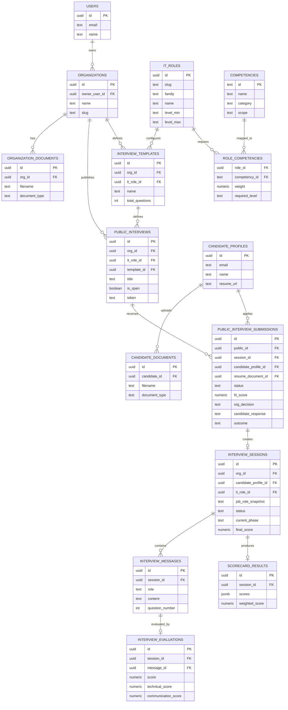

# 05 — Student-Level ERD Guide

> This is the **conceptual ERD** for a student project. It is not the full
> implementation schema. The full implementation is 30 tables in
> [`schema.sql`](schema.sql).
>
> Purpose: show the main entities and relationships without auth tokens, audit,
> event logs, or internal JSONB snapshots.

## 1. Recommended 15 tables

| # | Table | Why it belongs in the ERD |
|---:|---|---|
| 1 | `users` | Organization owner/recruiter account |
| 2 | `organizations` | Company/tenant that publishes interviews |
| 3 | `organization_documents` | IT documents used as organization knowledge |
| 4 | `it_roles` | IT role being interviewed for |
| 5 | `competencies` | Skills/competencies used for evaluation |
| 6 | `role_competencies` | Which competencies belong to which IT role |
| 7 | `candidate_profiles` | Candidate account and profile |
| 8 | `candidate_documents` | Candidate resume/CV |
| 9 | `public_interviews` | Opportunity Hub interview listing |
| 10 | `public_interview_submissions` | Candidate application, fit score, org decision, candidate response |
| 11 | `interview_templates` | Interview configuration for an IT role |
| 12 | `interview_sessions` | One interview attempt |
| 13 | `interview_messages` | Questions and answers |
| 14 | `interview_evaluations` | Score/feedback for each answer |
| 15 | `scorecard_results` | Final scorecard for the interview |

## 2. Optional tables

Add only if your lecturer expects the AI reasoning layer to be visible:

| Table | Purpose |
|---|---|
| `interview_brain` | Consolidated AI evaluation state and competency scores |
| `evidence_store` | Evidence extracted from candidate answers |
| `hypotheses` | AI hypotheses about candidate strengths/weaknesses |
| `interview_intelligence` | Consolidated AI context (company, candidate, blueprint, scorecard) |
| `scorecard_templates` | Reusable scorecard definitions |

## 3. Tables to omit from a student ERD

These are operational/technical tables, not core business entities:

- `refresh_tokens`
- `user_password_reset_tokens`
- `candidate_refresh_tokens`
- `candidate_password_reset_tokens`
- `candidate_invitations`
- `candidate_saved_listings`
- `interview_timeline`
- `interview_events`
- `v4_session_state`
- `audit_log`

They are necessary in code, but they add noise to a student ERD.

## 4. Mermaid ERD

## 5. Relationship rules to state in the report

- One `users` record can own one or more `organizations`; each organization has exactly one `owner_user_id`.
- One `organizations` record can have many `organization_documents` and many `public_interviews`.
- One `it_roles` record can be used by many `interview_templates` and many `interview_sessions`.
- One `role_competencies` row links exactly one `it_roles` record and one `competencies` record.
- One `candidate_profiles` record can upload many `candidate_documents`.
- One `public_interviews` listing can receive many `public_interview_submissions`.
- One `public_interview_submissions` row can create zero or one `interview_sessions`.
- One `interview_sessions` row has many `interview_messages` and one `scorecard_results` row.
- Each `interview_messages` row has zero or one `interview_evaluations` row.

## 6. What to explain in a student presentation

1. Candidate sees an interview in the Opportunity Hub.
2. Candidate applies with profile and resume.
3. Organization compares the candidate with IT role competencies and organization documents.
4. Organization invites or rejects the candidate.
5. Candidate accepts or declines the interview.
6. Interview session records questions, answers, and evaluations.
7. Final scorecard is produced.
8. Organization records the final outcome.

The 15-table ERD is enough to tell that story. Add the optional AI tables only if the presentation needs to show how the brain stores evidence.
